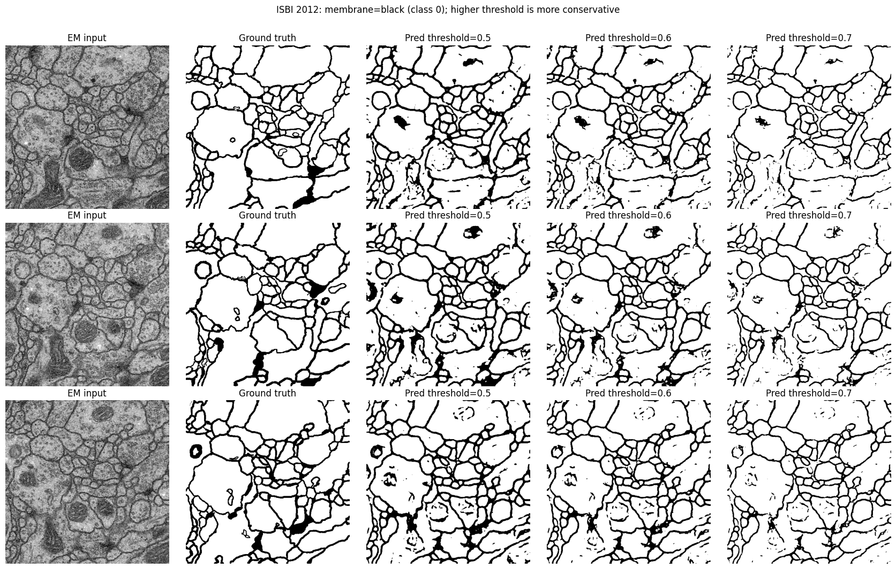
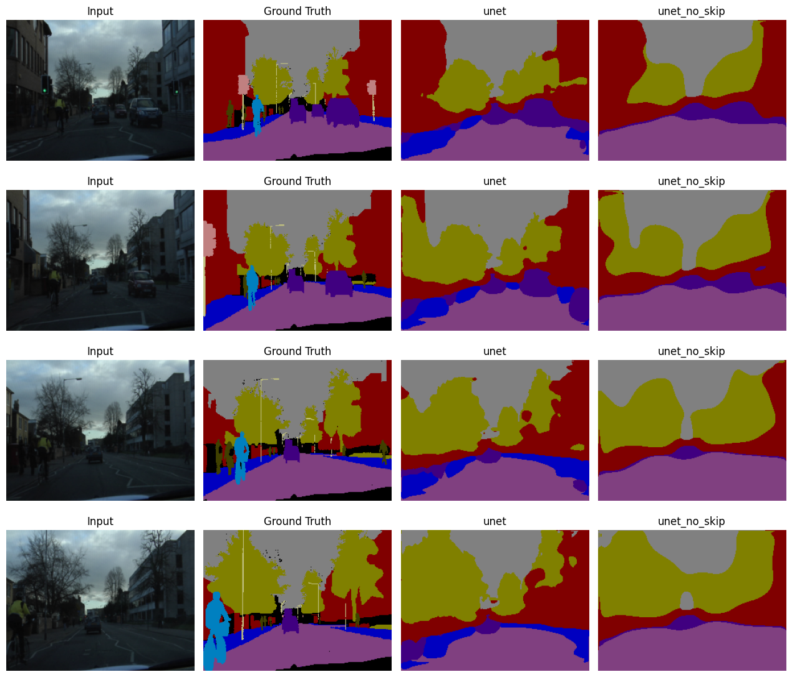
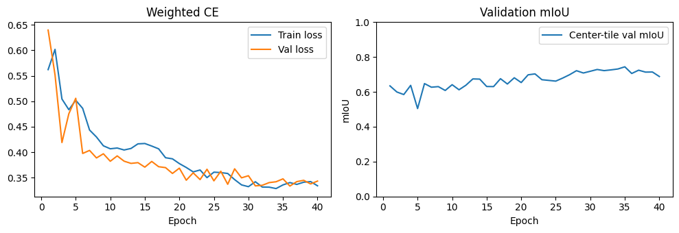

# U-Net 논문 재현 및 세그멘테이션 실험

[English](README.md) | **한국어**

**PyTorch · U-Net (MICCAI 2015) · CamVid · ISBI 2012**

논문 스터디에서 시작한 프로젝트입니다. 먼저 경량 U-Net을 도로 영상 세그멘테이션에 적용해 보고, 이어서 생물의학 전자현미경 영상용 원논문 구조에 더 가까운 U-Net을 구현했습니다. 원논문의 공식 벤치마크 점수를 재현하는 것이 아니라 아키텍처, ablation, 학습 안정성, 세그멘테이션 오류 분석에 초점을 맞췄습니다.

## 주요 결과

| 트랙 | 목표 | 핵심 결과 |
| --- | --- | --- |
| CamVid | 시맨틱 세그멘테이션과 skip connection ablation | LR 0.001, batch 8에서 test mIoU **0.3297** (skip) vs **0.2728** (no-skip) |
| ISBI 2012 | valid convolution, copy-and-crop, 학습형 업샘플링 재현 | **572×572 입력 → 388×388 출력** 검증 |
| ISBI 튜닝 | 세포 내부의 고립된 세포막 오탐 픽셀 줄이기 | 40 epoch, 세포막 threshold 0.6에서 전체 이미지 검증 mIoU **0.7388** |

> **범위:** 이 프로젝트는 *아키텍처 중심의 재현*입니다. CamVid 수치는 test split에서 평가했고, ISBI 수치는 비공개 ISBI test set이 아니라 *공개 학습 데이터*에서 따로 떼어 둔 6장으로 평가했습니다. 두 데이터셋의 점수는 서로 직접 비교하면 안 됩니다.

### ISBI 2012 — 정성적 결과



*따로 떼어 둔 공개 학습 슬라이스에 대한 예측입니다. 검은 픽셀이 세포막입니다. 세포막 threshold를 높이면 오탐은 줄지만 실제 세포막 픽셀을 놓칠 수도 있습니다.*

## 1. CamVid — 생물의학 영상 밖에서 U-Net 적용

[CamVid](http://mi.eng.cam.ac.uk/research/projects/VideoRec/CamVid/)는 도로 주행 영상에 픽셀 단위 의미 라벨(도로, 건물, 하늘, 차량, 보행자 등)이 붙은 데이터셋입니다. U-Net의 encoder-decoder 구조가 다른 도메인에서도 작동하는지, skip connection이 얼마나 기여하는지 확인하려고 선택했습니다.

- 11개 클래스 세그멘테이션, 라벨 없음/void 픽셀은 무시. **학습 367 / 검증 101 / 테스트 233장**.
- RGB 입력을 **192×256**으로 리사이즈하고, 첫 채널 수 **16**인 경량 네트워크 사용.
- same padding convolution, bilinear 업샘플링, Adam, cross-entropy, **20 epochs**.
- No-skip ablation은 skip 텐서의 encoder feature를 0으로 채워 decoder의 형태와 파라미터 수를 그대로 유지합니다. decoder 파라미터를 제거하는 방식은 **아닙니다**.

### CamVid 테스트 결과

| Learning rate | Batch size | U-Net mIoU | No-skip mIoU |
| ---: | ---: | ---: | ---: |
| 0.001 | 8 | **0.3297** | 0.2728 |
| 0.0003 | 8 | 0.2849 | 0.2470 |
| 0.001 | 4 | **0.3464** | 0.3460 |



[Batch 8 노트북](notebooks/camvid_unet_baseline_bs8.ipynb) · [Batch 4 노트북](notebooks/camvid_unet_batch4.ipynb) · [낮은 LR 추가 실험 Colab](https://colab.research.google.com/drive/1EOwPPR6L0HSJRXNVQhSDa4Fe25RRh0I6) · [CamVid 학습 곡선](figures/camvid_learning_curves.png)

LR 0.0003 no-skip 실험은 mIoU만 기록했기 때문에, [`results/camvid_test_metrics.csv`](results/camvid_test_metrics.csv)에서 Dice와 pixel accuracy는 추정하지 않고 빈칸으로 두었습니다.

**해석:** batch 8에서는 skip connection이 도움이 됐지만 batch 4에서는 뚜렷한 차이가 없었습니다. batch가 작아지면 epoch당 optimizer 업데이트 횟수도 늘어납니다. 각 설정을 한 번씩만 실행했으므로, 어떤 변화가 항상 도움이 된다고 단정할 수는 없습니다.

## 2. ISBI 2012 — 원논문 구조에 더 가깝게

원논문은 [ISBI 2012 EM 세그멘테이션 과제](https://imagej.net/events/isbi-2012-segmentation-challenge)를 포함한 생물의학 영상을 사용했습니다. 라벨이 있는 **512×512 흑백 슬라이스 30장** 중 **24장**을 학습, **6장**을 검증에 사용했습니다. 여기서 세포막은 **클래스 0, 검정**입니다.

| 구성 요소 | 이 구현 | 원논문 충실도 |
| --- | --- | --- |
| Encoder/decoder | 3×3 valid convolution (`padding=0`), max pooling | 재현 |
| Skip 경로 | encoder feature를 가운데 기준으로 잘라 concat | 재현 |
| 업샘플링 | 학습형 2×2 transposed convolution | 재현 |
| 채널 수와 크기 | 첫 채널 64, **572×572 → 388×388** | 논문 기본 구조와 일치 |
| 전체 이미지 추론 | 반사 패딩 + overlap-tile 방식 | 논문과 유사 |
| 데이터 증강 | 반전/회전, 밝기 변화, elastic deformation 근사 | 근사 |
| Loss | 세포막까지의 거리 기반 경계 가중치를 준 weighted cross-entropy | 논문의 인스턴스 기반(가장 가까운 두 세포) 가중치는 **아님** |
| 최적화 | SGD, momentum 0.99, batch 1, LR / epoch 조정 | 원논문 전체 학습 스케줄은 **미재현** |
| 평가 | 따로 떼어 둔 공개 슬라이스 6장의 mIoU, Dice, 세포막 IoU | 공식 비공개 챌린지 벤치마크 **아님** |



*저장된 곡선에서 검증 loss는 검증 슬라이스로 계산한 클래스 가중치를 사용했습니다. 현재 코드는 학습셋 가중치를 그대로 써서 학습 loss와 검증 loss가 같은 기준을 갖습니다. 체크포인트 선택과 보고한 IoU/Dice 값은 loss를 쓰지 않으므로 영향을 받지 않습니다.*

### 학습 및 하이퍼파라미터 실험

학습 초기에 모델이 한 클래스만 예측하는 쪽으로 무너지는 경우가 있었습니다. 그래서 낮은 learning rate, 더 긴 학습, 경계 loss 가중치 축소를 실험했습니다. 더 오래 학습하면 검증 성능이 좋아졌고, 근사 경계 가중치를 없애면 나빠졌습니다.

| 실험 | LR | Epochs | Boundary boost | Threshold | 전체 이미지 검증 mIoU | 세포막 IoU |
| --- | ---: | ---: | ---: | ---: | ---: | ---: |
| 초기 설정 | 0.01 | 12 | 2.0 | 0.5 | 0.5813 | 0.4260 |
| LR 낮추고 더 길게 학습 | 0.001 | 20 | 2.0 | 0.5 | 0.6842 | 0.5343 |
| Boundary boost 제거 | 0.001 | 20 | 0.0 | 0.5 | 0.6577 | 0.4923 |
| Threshold 비교용 20 epoch 실험 | 0.001 | 20 | 2.0 | 0.5 | 0.6859 | 0.5350 |
| 20 epochs + threshold 0.6 | 0.001 | 20 | 2.0 | 0.6 | 0.7028 | 0.5446 |
| Threshold 비교용 40 epoch 실험 | 0.001 | 40 | 2.0 | 0.5 | 0.7352 | **0.5976** |
| **40 epochs + threshold 0.6** | **0.001** | **40** | **2.0** | **0.6** | **0.7388** | 0.5938 |

두 20 epoch 실험은 별도로 학습한 것이라 점수가 똑같을 필요는 없습니다. 첫 두 행 사이에 LR과 epoch이 함께 바뀌었으므로, 개선을 LR만의 효과로 볼 수 없습니다. Threshold를 0.6으로 올리면 20 epoch과 40 epoch 모두에서 mIoU가 올랐습니다.

### 오류 분석 — 세포 내부의 고립된 검은 점

세포막 오탐을 줄이기 위해, 저장된 40 epoch 체크포인트에서 재학습 없이 **클래스 0의 확률 threshold**를 바꿔 가며 비교했습니다.

| 세포막 threshold | mIoU | 세포막 IoU | Precision | Recall | 세포막 오탐 픽셀 |
| ---: | ---: | ---: | ---: | ---: | ---: |
| 0.5 | 0.7352 | **0.5976** | 0.6960 | **0.8088** | 109,150 |
| **0.6** | **0.7388** | 0.5938 | 0.7509 | 0.7395 | 75,820 |
| 0.7 | 0.7254 | 0.5637 | **0.8124** | 0.6480 | **46,249** |

Threshold 0.6에서는 0.5 대비 세포막 오탐 픽셀이 **30.5%** 줄었고 전체 mIoU는 조금 올랐습니다. 하지만 **세포막 IoU와 recall은 떨어졌습니다.** 모든 지표가 좋아진 것이 아니라 trade-off입니다.

**선택 기준:** 0.6은 전체 검증 mIoU가 가장 높아서 골랐습니다. `run_threshold_sweep()`도 같은 기준을 쓰고, 선택한 값 옆에 세포막 IoU, recall, 오탐 변화량을 함께 출력합니다. 세포막 IoU만 기준으로 하면 0.5가 선택됩니다.

[Threshold 비교 이미지 원본 크기로 보기](figures/isbi_threshold_comparison.png)

[ISBI 학습 모델 예측](figures/isbi_predictions.png) · [최종 코드 노트북(출력 제거)](notebooks/isbi2012_paper_style_epoch40.ipynb) · [출력이 포함된 원본 Colab](https://colab.research.google.com/drive/1VZBbi64BACQJgoDD09YBTczfm3vETUEj)

## 파일 구성과 재현 방법

| 경로 | 내용 |
| --- | --- |
| `notebooks/` | 출력이 저장된 CamVid 실험 노트북, 레포 용량을 줄이려고 출력을 지운 ISBI 노트북 |
| `src/` | 보기 쉽도록 노트북에서 추출한 Python 코드 |
| `figures/` | 실제로 기록한 학습 곡선과 세그멘테이션 예측 |
| `results/` | 보고한 지표의 CSV 요약 |
| `requirements.txt` | 주요 Python 의존성 |

레포 루트에서 로컬로 실행하는 방법입니다(특히 전체 채널 ISBI 모델은 **GPU를 강력히 권장**합니다).

```bash
python -m pip install -r requirements.txt
python src/camvid_unet.py
python src/isbi2012_unet.py
```

두 스크립트는 각각 따로 실행할 수 있습니다. 각 스크립트는 공개 미러에서 데이터셋을 내려받고, 결과를 각자의 출력 폴더에 저장합니다. ISBI 스크립트는 먼저 모델을 학습한 뒤, 저장된 최고 체크포인트로 threshold를 평가합니다. Threshold 단계는 모듈을 import해서 `run_threshold_sweep()`으로 따로 실행할 수도 있습니다. 노트북을 **GPU 런타임의 Google Colab**에서 열어 실행해도 됩니다. ISBI 노트북의 threshold 섹션에는 앞 학습 단계에서 만든 `isbi2012_unet_paper_results/best_paper_unet.pt`(또는 구조가 같은 기존 체크포인트)가 필요합니다. **데이터셋 TIFF 파일과 학습된 체크포인트는 이 레포에 포함하지 않습니다.**

## 한계

- 최고 체크포인트와 threshold를 **같은 ISBI 검증 슬라이스 6장**으로 골랐기 때문에 독립적인 test 성능 추정이 아닙니다. 인접한 슬라이스끼리는 서로 상관이 있을 수 있습니다.
- 여러 seed로 반복한 안정성 실험, 공식 ISBI 챌린지 평가, 원논문의 정확한 '가장 가까운 두 세포' 기반 loss 가중치는 하지 않았습니다.
- 세포 내부의 고립된 세포막 오탐과 끊긴 윤곽선이 남아 있습니다. Threshold 조정은 한 가지 오류를 줄이는 대신 recall을 희생합니다.
- 데이터셋, 과제, 지표가 다르므로 CamVid와 ISBI의 mIoU는 서로 비교할 수 없습니다.

## 참고 자료

- Ronneberger, Fischer and Brox. [U-Net: Convolutional Networks for Biomedical Image Segmentation](https://arxiv.org/abs/1505.04597), MICCAI 2015.
- [ISBI 2012 EM Segmentation Challenge](https://imagej.net/events/isbi-2012-segmentation-challenge) · [TIFF 미러](https://github.com/zhixuhao/unet/tree/master/data/membrane).
- [CamVid](http://mi.eng.cam.ac.uk/research/projects/VideoRec/CamVid/) · [11개 클래스 데이터 미러](https://github.com/stonewst/CamVid-for-Segmentation).
