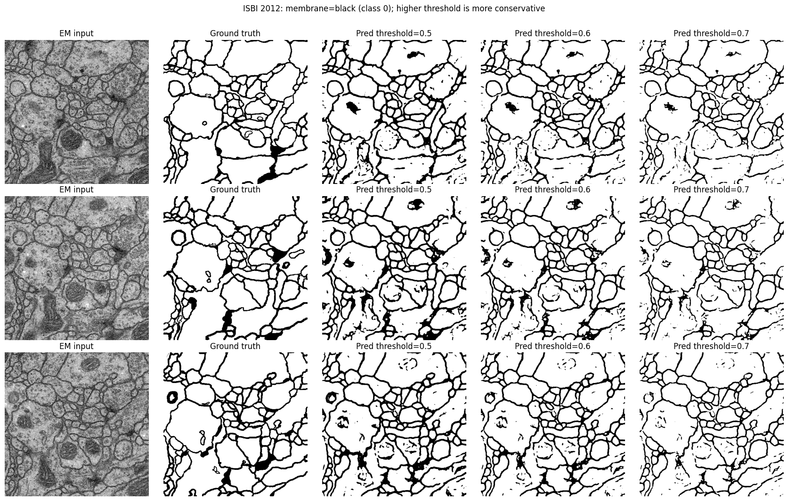
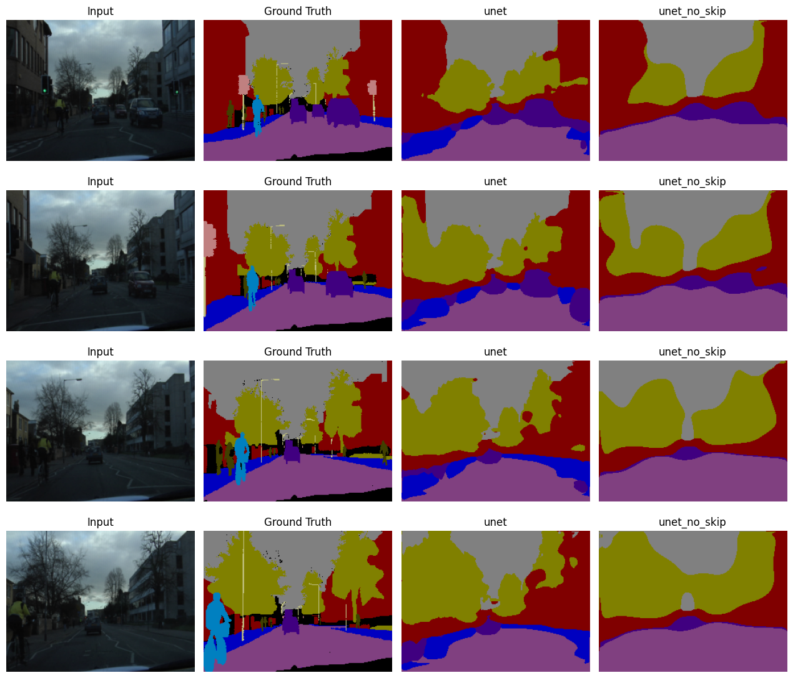
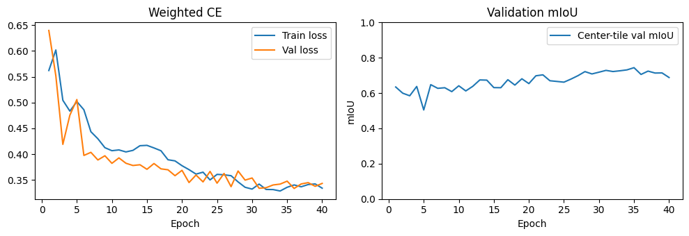

# U-Net Paper Reproduction & Segmentation Experiments

**English** | [한국어](README.ko.md)

**PyTorch · U-Net (MICCAI 2015) · CamVid · ISBI 2012**

From a paper-reading study: I first tested a lightweight U-Net on road-scene segmentation, then implemented a version closer to the original U-Net for biomedical electron microscopy. The project focuses on architecture, ablation, training stability, and segmentation errors—not on reproducing the original paper's official benchmark.

## Highlights

| Track | Objective | Key result |
| --- | --- | --- |
| CamVid | Semantic segmentation and skip-connection ablation | Test mIoU **0.3297** (skip) vs **0.2728** (no-skip) at LR 0.001, batch 8 |
| ISBI 2012 | Reproduce valid convolutions, copy-and-crop, and learned upsampling | Verified **572×572 input → 388×388 output** |
| ISBI tuning | Reduce isolated false-positive membrane pixels | Full-image validation mIoU **0.7388** at 40 epochs, membrane threshold 0.6 |

> **Scope:** This is an *architecture-focused reproduction*. CamVid numbers are evaluated on its test split; ISBI numbers use six held-out slices from the *public training data*, not the hidden ISBI test set. Scores across the two datasets should not be compared directly.

### ISBI 2012 — qualitative results



*Predictions on held-out public training slices. Black pixels denote cell membranes; raising the membrane threshold reduces false positives but can also miss true membrane pixels.*

## 1. CamVid — applying U-Net outside biomedical imaging

[CamVid](http://mi.eng.cam.ac.uk/research/projects/VideoRec/CamVid/) consists of road-driving images with pixel-level semantic labels (road, buildings, sky, vehicles, pedestrians, and others). I selected it to see whether the U-Net encoder-decoder works on a different domain and to test the contribution of skip connections.

- 11-class segmentation, with unlabeled/void pixels ignored; **367 train / 101 validation / 233 test**.
- RGB inputs resized to **192×256**; lightweight **16-base-channel** network.
- Same-padded convolutions, bilinear upsampling, Adam, cross-entropy; **20 epochs**.
- No-skip ablation uses zero-valued encoder features in the skip tensors, preserving decoder shape/parameter count. It does **not** remove decoder parameters.

### CamVid test results

| Learning rate | Batch size | U-Net mIoU | No-skip mIoU |
| ---: | ---: | ---: | ---: |
| 0.001 | 8 | **0.3297** | 0.2728 |
| 0.0003 | 8 | 0.2849 | 0.2470 |
| 0.001 | 4 | **0.3464** | 0.3460 |



[Batch-8 notebook](notebooks/camvid_unet_baseline_bs8.ipynb) · [Batch-4 notebook](notebooks/camvid_unet_batch4.ipynb) · [Additional lower-LR Colab run](https://colab.research.google.com/drive/1EOwPPR6L0HSJRXNVQhSDa4Fe25RRh0I6) · [CamVid curves](figures/camvid_learning_curves.png)

The no-skip run at LR 0.0003 recorded only mIoU; its Dice and pixel accuracy are left blank in [`results/camvid_test_metrics.csv`](results/camvid_test_metrics.csv) rather than estimated.

**Interpretation:** Skip connections helped at batch size 8 but not clearly at batch size 4. A smaller batch size also increases optimizer updates per epoch. These experiments use single runs, so they do not prove that any one change consistently helps.

## 2. ISBI 2012 — closer to the original architecture

The paper used biomedical imagery including the [ISBI 2012 EM segmentation task](https://imagej.net/events/isbi-2012-segmentation-challenge). I used **30 labeled 512×512 grayscale slices**, reserving **24** for training and **6** for validation. Here the **membrane is class 0 (black)**.

| Component | This implementation | Original-paper fidelity |
| --- | --- | --- |
| Encoder/decoder | 3×3 valid convolutions (`padding=0`), max pooling | Reproduced |
| Skip paths | Center-crop encoder features, then concatenate | Reproduced |
| Upsampling | Learned 2×2 transposed convolutions | Reproduced |
| Channels and geometry | Base width 64; **572×572 → 388×388** | Matches canonical paper architecture |
| Full-image inference | Reflection padding / overlap-tile approach | Similar to the paper |
| Augmentation | Flips/rotations, intensity variation, approximate elastic deformation | Approximation |
| Loss | Weighted cross-entropy with membrane-distance-based boundary weight | **Not** the paper's instance-aware nearest-two-cell weight |
| Optimization | SGD, momentum 0.99, batch 1; tuned LR / epochs | Original full learning schedule **not** reproduced |
| Evaluation | mIoU, Dice and membrane IoU on six held-out public slices | **Not** the official hidden challenge benchmark |



*In the recorded curves, validation loss used class weights computed from the validation slices. The current code reuses the training-set weights so train and validation loss share one scale. Checkpoint selection and all reported IoU/Dice values are unaffected, because they do not use the loss.*

### Training and hyperparameter experiments

Early training sometimes collapsed toward a single-class prediction. I investigated lower learning rates, longer training, and a reduced boundary-loss weight. Training longer improved validation overlap; removing the approximate boundary weight degraded it.

| Run | LR | Epochs | Boundary boost | Threshold | Full-image val mIoU | Membrane IoU |
| --- | ---: | ---: | ---: | ---: | ---: | ---: |
| Initial | 0.01 | 12 | 2.0 | 0.5 | 0.5813 | 0.4260 |
| Lower LR and longer training | 0.001 | 20 | 2.0 | 0.5 | 0.6842 | 0.5343 |
| Remove boundary boost | 0.001 | 20 | 0.0 | 0.5 | 0.6577 | 0.4923 |
| Threshold-sweep 20-epoch run | 0.001 | 20 | 2.0 | 0.5 | 0.6859 | 0.5350 |
| 20 epochs + threshold 0.6 | 0.001 | 20 | 2.0 | 0.6 | 0.7028 | 0.5446 |
| Threshold-sweep 40-epoch run | 0.001 | 40 | 2.0 | 0.5 | 0.7352 | **0.5976** |
| **40 epochs + threshold 0.6** | **0.001** | **40** | **2.0** | **0.6** | **0.7388** | 0.5938 |

The two 20-epoch runs were separate training runs and need not have identical scores. Because both LR and epochs changed between the first two rows, improvements cannot be attributed to LR alone. Raising the threshold to 0.6 increased mIoU at both 20 and 40 epochs.

### Error analysis — isolated black spots in cell interiors

To suppress false-positive membrane predictions, I swept the **probability threshold for class 0** on a saved 40-epoch checkpoint, without retraining.

| Membrane threshold | mIoU | Membrane IoU | Precision | Recall | False-positive membrane pixels |
| ---: | ---: | ---: | ---: | ---: | ---: |
| 0.5 | 0.7352 | **0.5976** | 0.6960 | **0.8088** | 109,150 |
| **0.6** | **0.7388** | 0.5938 | 0.7509 | 0.7395 | 75,820 |
| 0.7 | 0.7254 | 0.5637 | **0.8124** | 0.6480 | **46,249** |

At threshold 0.6, false-positive membrane pixels decreased **30.5%** relative to threshold 0.5, while overall mIoU increased slightly. **Membrane IoU and recall decreased**, however: this threshold is a trade-off, not an improvement in every metric.

**Selection criterion:** 0.6 is chosen because it gives the highest overall validation mIoU; `run_threshold_sweep()` applies the same rule and prints the membrane IoU, recall and false-positive change next to it. Selecting by membrane IoU alone would keep 0.5.

[Open the full-size threshold comparison](figures/isbi_threshold_comparison.png)

[ISBI trained predictions](figures/isbi_predictions.png) · [Final code-only notebook](notebooks/isbi2012_paper_style_epoch40.ipynb) · [Original executed Colab with outputs](https://colab.research.google.com/drive/1VZBbi64BACQJgoDD09YBTczfm3vETUEj)

## Files and reproduction

| Path | Contents |
| --- | --- |
| `notebooks/` | CamVid experiments with saved outputs; ISBI notebook with outputs removed to reduce repository size |
| `src/` | Python code extracted from the notebooks for easier inspection |
| `figures/` | Actual recorded training curves and segmentation predictions |
| `results/` | CSV summaries of reported metrics |
| `requirements.txt` | Main Python dependencies |

For a local run from the repository root (a **GPU is strongly recommended**, especially for the full-width ISBI model):

```bash
python -m pip install -r requirements.txt
python src/camvid_unet.py
python src/isbi2012_unet.py
```

Run either script independently: each downloads its dataset from a public mirror and saves generated results in its corresponding output directory. The ISBI script trains the model first, then evaluates thresholds on its saved best checkpoint; the threshold step is also available as `run_threshold_sweep()` when imported. You can alternatively open the notebooks in **Google Colab with a GPU runtime**. The ISBI notebook's threshold section requires `isbi2012_unet_paper_results/best_paper_unet.pt` from the preceding training step (or an existing matching checkpoint). **No dataset TIFF files or pretrained checkpoints are redistributed here.**

## Limitations

- The **same six ISBI validation slices** were used to select the best checkpoint and threshold; this is not an independent test estimate, and adjacent image slices may be correlated.
- No multi-seed robustness study, official ISBI challenge evaluation, or exact nearest-two-cell loss weighting was performed.
- Isolated false-positive membrane spots and disconnected contours remain; thresholding improves one error type at the expense of recall.
- Dataset/task/metric differences make CamVid and ISBI mIoU values incomparable.

## References

- Ronneberger, Fischer and Brox. [U-Net: Convolutional Networks for Biomedical Image Segmentation](https://arxiv.org/abs/1505.04597), MICCAI 2015.
- [ISBI 2012 EM Segmentation Challenge](https://imagej.net/events/isbi-2012-segmentation-challenge) · [TIFF mirror](https://github.com/zhixuhao/unet/tree/master/data/membrane).
- [CamVid](http://mi.eng.cam.ac.uk/research/projects/VideoRec/CamVid/) · [11-class data mirror](https://github.com/stonewst/CamVid-for-Segmentation).
